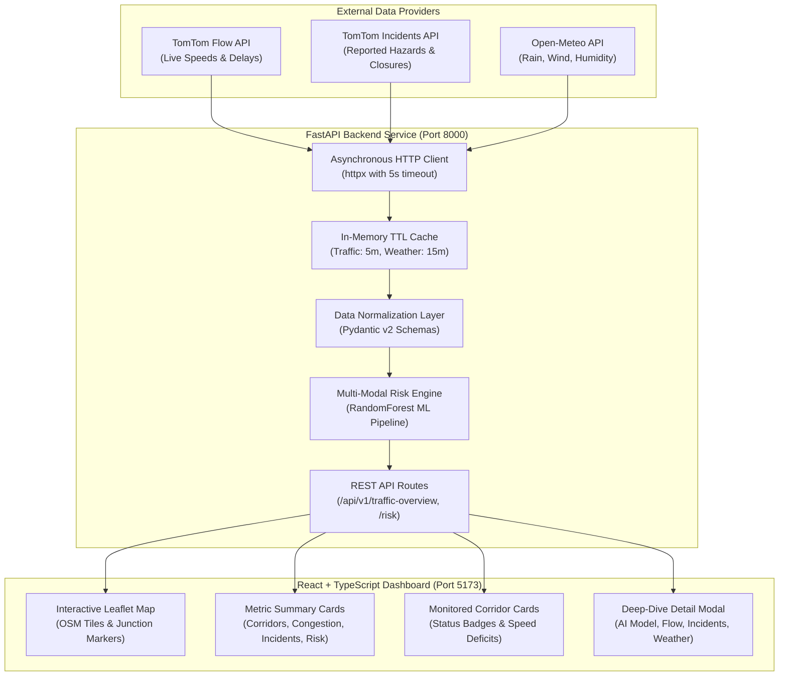

# Multimodal AI-Based Smart Traffic Management and Accident Prediction System

An intelligent traffic safety and risk estimation platform designed to monitor selected traffic corridors and intersections in **Hyderabad, India**. By synthesizing real-time traffic flow data, provider-reported road incidents, atmospheric weather conditions, and a trained machine learning accident severity model, the system computes location-specific accident risk estimates and surfaces actionable insights through an interactive dashboard.

---

## 1. Project Overview & Architecture

Urban corridors in metropolitan hubs like Hyderabad experience severe congestion peaks, monsoon-driven waterlogging hazards, and localized collision hotspots. This platform provides continuous, multi-modal situational awareness by unifying three distinct live data feeds and an offline-trained predictive model:

1. **Traffic Congestion & Flow:** Live vehicle speeds, normal free-flow speeds, and calculated congestion ratios ingested via TomTom Traffic Flow APIs.
2. **Reported Incidents:** Verified external provider events (accidents, roadworks, stationary vehicles, lane closures) ingested via TomTom Incidents APIs.
3. **Atmospheric Weather:** Real-time precipitation, rainfall, temperature, relative humidity, and wind conditions ingested via Open-Meteo APIs.
4. **Accident Severity Propensity Model:** A Scikit-learn machine learning pipeline (`RandomForestClassifier`) trained on pre-crash roadway, environmental, and temporal features to estimate relative crash severity propensity without post-crash data leakage.



> **Strict Architectural Philosophy:**
> - Zero dependency on uploaded video files or manual video feeds. Telemetry is purely API-driven.
> - Crisp domain separation: “Reported incident” (provider event) $\neq$ “Traffic congestion” (speed deficit) $\neq$ “Predicted accident risk” (model estimate).
> - Zero data fabrication: If telemetry is unavailable or credentials are omitted, the system returns explicit typed unavailable states rather than synthetic or hallucinated numbers.

---

## 2. Repository Structure

```text
smart-traffic-ai/
├── AGENTS.md                  # Core operational boundaries and guidelines for development
├── README.md                  # Primary project guide, architecture overview, and onboarding
├── .gitignore                 # Excludes virtual environments, caches, .env files, and raw data
├── .env.example               # Root environment configuration template
├── docs/                      # Architectural designs, deployment plans, and ADRs
│   ├── architecture.md        # Detailed component boundaries and end-to-end dataflow
│   ├── deployment-plan.md     # Deployment readiness assessment, hosting limits & demo plan
│   ├── implementation-plan.md # Phased implementation tracker (Phases 0–7 completed)
│   └── decisions/             # Architecture Decision Records (ADRs)
│       └── ADR-001-initial-architecture.md
├── backend/                   # Python FastAPI asynchronous backend
│   ├── app/
│   │   ├── api/routes/        # REST endpoints (health, locations, traffic, weather, risk)
│   │   ├── core/config.py     # Resilient Pydantic settings with secret protection
│   │   ├── models/            # Serialized ML model artifacts (model_baseline.joblib)
│   │   ├── schemas/           # Pydantic data validation and serialization models
│   │   └── services/          # External API clients (TomTom, Open-Meteo) & risk engine
│   ├── tests/                 # Automated pytest suite (27 tests covering all layers)
│   ├── requirements.txt       # Pinned production and test dependencies
│   ├── .env.example           # Backend environment template
│   └── README.md              # Backend-specific architecture and setup documentation
├── frontend/                  # React 18 + TypeScript + Vite frontend
│   ├── src/
│   │   ├── components/        # UI components (Header, MapView, LocationCard, DetailModal)
│   │   ├── services/api.ts    # Frontend API client communicating with FastAPI
│   │   ├── types/index.ts     # TypeScript interfaces mirroring FastAPI backend schemas
│   │   ├── App.tsx            # Main layout orchestrator
│   │   ├── main.tsx           # React DOM application mount point
│   │   └── index.css          # Global CSS layout and custom Leaflet pin animations
│   ├── package.json           # Node dependencies, build scripts (lint, build, dev)
│   ├── tsconfig.json          # Strict TypeScript compiler options
│   ├── vite.config.ts         # Vite bundler configuration with backend reverse proxy
│   └── README.md              # Frontend-specific architecture and setup documentation
├── data/                      # Geospatial and benchmark historical records
│   ├── locations/             # Authoritative Hyderabad monitored junctions (GeoJSON/JSON)
│   └── historical/            # Data documentation, quality reports, and model metrics
└── scripts/                   # Reproducible data generation and ML training utilities
    ├── generate_sample_dataset.py # Generates 850 reproducible historical records
    ├── data_prep.py               # Preprocesses features with zero post-crash leakage
    └── train_risk_model.py        # Trains and evaluates the RandomForest severity pipeline
```

---

## 3. Features Actually Implemented

- **Authoritative Hyderabad Corridor Registry:** Curated coordinates, bounding radiuses, and geometry metadata for 5 key junctions:
  - Gachibowli Junction (`hyd-gachibowli`)
  - Hitech City / Cyber Towers (`hyd-hitech-city`)
  - Madhapur / Mindspace (`hyd-madhapur`)
  - Kukatpally ‘Y’ Junction (`hyd-kukatpally`)
  - Jubilee Hills Checkpost (`hyd-jubilee-hills`)
- **Real-Time Weather Telemetry:** Live Open-Meteo ingestion with in-memory TTL caching (15 min) and automatic WMO weather code mapping.
- **Real-Time Traffic Dynamics:** Live speed, delay, and congestion index calculation ($1 - \text{currentSpeed}/\text{freeFlowSpeed}$) via TomTom Flow API.
- **Provider-Reported Incidents:** Haversine radius matching (3 km) filtering confirmed vehicular accidents from traffic jams and roadworks.
- **Accident Risk Engine:** Composite risk score ($0 - 100$) integrating live speed deficits, weather hazards, temporal peak hours, and ML severity propensity.
- **Trained Machine Learning Pipeline:** Serialized Scikit-learn model (`model_baseline.joblib`) with `ColumnTransformer` (standard scaling + one-hot encoding with `handle_unknown='ignore'`) predicting incident severity propensity under class imbalance.
- **Interactive React Dashboard:**
  - Interactive Leaflet map with OpenStreetMap tiles, custom status pins, and junction popups.
  - Summary metrics tracking total corridors, congestion availability, reported road incidents, and elevated risk junctions.
  - Corridor cards with color-coded risk tier badges (`LOW`, `MODERATE`, `HIGH`, `CRITICAL`, `UNAVAILABLE`).
  - Tabbed detail modal providing full breakdowns of traffic flow, reported incidents, weather telemetry, and an audit table of observed features passed to the AI model.
- **Provider Resilience:** Degradation or timeout of any single external API provider never crashes the application; responses gracefully return `partially_degraded` with diagnostic status codes.

---

## 4. Visual Interface & Screenshots Walkthrough

*(Capture these views from the live application for project presentations and defense documentation)*:

### View 1: Main Monitoring Dashboard
- **Location:** Full application view at `http://localhost:5173`.
- **Displays:** Split view featuring the interactive Leaflet map of Hyderabad on the left (with numerical speed markers) and monitored corridor cards on the right.
- **Key Indicators:** Top summary counters (Monitored Corridors, Traffic Congestion, Reported Incidents, Predicted Risk) and connection health badges in the header (`FastAPI: Online`, `Open-Meteo: Active`, `TomTom: Configured`, `AI Risk Model: Active`).

### View 2: AI Risk Model Deep-Dive Modal
- **Location:** Opened by clicking any corridor card and selecting the **"AI Risk Model"** tab.
- **Displays:** Estimated Accident Risk Index ($0 - 100$), categorical risk badge (`LOW`, `MODERATE`, `HIGH`, `CRITICAL`), ML model severity propensity (`Minor` vs. `Severe/Fatal`), interactive risk factor progress bars (speed deficit, weather hazard, temporal risk, geometry), and an audit table showing raw empirical inputs fed to the pipeline.

### View 3: Traffic Dynamics & Speed Deficit
- **Location:** Location Detail Modal (`Traffic Dynamics` tab).
- **Displays:** Observed speed vs. free-flow speed, estimated delay in seconds, travel time, and calculated congestion ratio percentage.

### View 4: Provider-Reported Incidents Feed
- **Location:** Location Detail Modal (`Reported Incidents` tab).
- **Displays:** Verified events reported by TomTom within 3 km with distance, severity tags, delay, and a clear distinction between confirmed accidents and ordinary congestion.

### View 5: Unconfigured / Fallback State
- **Location:** Dashboard when `TOMTOM_API_KEY` is omitted from `backend/.env`.
- **Displays:** Amber notification banner guiding the user on where to obtain an optional TomTom key, while Open-Meteo weather and AI risk estimation continue operating seamlessly with honest `Unconfigured` tags for speed flow.

---

## 5. Prerequisites & Windows Setup Instructions

### Prerequisites
- **Python:** 3.10 to 3.12 (Python 3.12.10 recommended)
- **Node.js:** 18.x or 20.x+ (Node 22.x LTS verified)
- **Git:** Installed on Windows (`git --version`)

### Step-by-Step Installation

#### 1. Open the Repository Directory
```powershell
cd "c:\Users\varsh\OneDrive\Desktop\final major project"
```

#### 2. Configure Backend Python Environment
```powershell
# Navigate to backend directory
cd backend

# Create virtual environment named .venv (if not already created)
python -m venv .venv

# Activate the virtual environment
.\.venv\Scripts\Activate.ps1

# Upgrade pip and install pinned backend dependencies
pip install --upgrade pip
pip install -r requirements.txt

# Return to repository root
cd ..
```

#### 3. Configure Frontend Node Environment
```powershell
# Navigate to frontend directory
cd frontend

# Install dependencies
npm install

# Return to repository root
cd ..
```

---

## 6. How to Configure API Credentials

The system requires only **one optional external credential** (`TOMTOM_API_KEY`). Open-Meteo weather requires no API key.

1. Create `backend/.env` from the provided template:
   ```powershell
   Copy-Item backend\.env.example backend\.env
   ```
2. Open `backend/.env` in your editor:
   ```env
   BACKEND_HOST=127.0.0.1
   BACKEND_PORT=8000
   ENVIRONMENT=development
   CORS_ORIGINS=http://localhost:5173,http://127.0.0.1:5173

   # Optional TomTom Developer Key (register free at https://developer.tomtom.com/)
   TOMTOM_API_KEY=your_actual_tomtom_api_key_here

   OPEN_METEO_BASE_URL=https://api.open-meteo.com/v1
   REQUEST_TIMEOUT_SECONDS=5.0
   TRAFFIC_CACHE_TTL_SECONDS=300
   WEATHER_CACHE_TTL_SECONDS=900
   ```
3. **No-Key Development Mode:** If `TOMTOM_API_KEY` is omitted or left as placeholder, the system runs normally:
   - Weather telemetry and AI severity propensity remain 100% operational.
   - Traffic speeds and provider incidents report `TomTom Unconfigured` without crashing.

---

## 7. Running the Application (Two Terminals)

Open two separate PowerShell windows:

### Terminal 1: Backend Server (FastAPI)
```powershell
# Option A: Run directly using virtual environment binary
.\backend\.venv\Scripts\python.exe -m uvicorn app.main:app --reload --app-dir backend --host 127.0.0.1 --port 8000

# Option B: Run from inside backend directory with activated venv
cd backend
.\.venv\Scripts\Activate.ps1
uvicorn app.main:app --reload --host 127.0.0.1 --port 8000
```
- API Base URL: `http://127.0.0.1:8000`
- Interactive API Documentation (Swagger): `http://127.0.0.1:8000/docs`

### Terminal 2: Frontend Dashboard (Vite + React)
```powershell
cd frontend
npm run dev
```
- Local Dashboard URL: `http://localhost:5173`

---

## 8. Available API Endpoints

All application routes are served under `/api/v1` with automatic interactive documentation at `/docs`:

| Endpoint | Method | Query Parameters | Description |
|---|---|---|---|
| `GET /` | `GET` | — | Service metadata, active version, and endpoint registry |
| `GET /api/v1/health` | `GET` | — | Service health check and operational status |
| `GET /api/v1/locations` | `GET` | — | Authoritative list of all monitored Hyderabad junctions |
| `GET /api/v1/locations/{id}` | `GET` | — | Metadata and coordinates for a single location |
| `GET /api/v1/locations/{id}/weather` | `GET` | `force_refresh: bool` | Real-time weather observation from Open-Meteo |
| `GET /api/v1/locations/{id}/traffic` | `GET` | `force_refresh: bool` | Real-time speeds, delay, and congestion index from TomTom |
| `GET /api/v1/locations/{id}/incidents` | `GET` | `radius_km: float`, `force_refresh: bool` | Active provider-reported road incidents within radius |
| `GET /api/v1/locations/{id}/risk` | `GET` | `force_refresh: bool` | Multi-factor accident risk index and ML severity prediction |
| `GET /api/v1/traffic-overview` | `GET` | `force_refresh: bool` | Concurrent city-wide aggregation of all telemetry and risk scores |

---

## 9. How to Run Tests and Retrain the Model

### Running Backend Automated Tests
All 27 automated tests mock external network boundaries and run fully offline:
```powershell
.\backend\.venv\Scripts\python.exe -m pytest -v backend/tests
```

### Running Frontend Typecheck & Build
```powershell
cd frontend
npm run lint    # Strict TypeScript type check (tsc --noEmit)
npm run build   # Production compilation & Vite chunk bundling
```

### Reproducible Dataset Generation & Model Training
To regenerate the historical benchmark dataset and retrain the Scikit-learn severity pipeline:
```powershell
# 1. Generate benchmark historical records (850 rows)
.\backend\.venv\Scripts\python.exe scripts/generate_sample_dataset.py

# 2. Run preprocessing & leakage-free feature engineering
.\backend\.venv\Scripts\python.exe scripts/data_prep.py

# 3. Fit RandomForest pipeline & export metrics
.\backend\.venv\Scripts\python.exe scripts/train_risk_model.py
```
- Preprocessing audit log: `data/historical/processed/data_quality_report.json`
- Model metrics: `data/historical/processed/model_metrics.json`
- Active model artifact: `backend/app/models/model_baseline.joblib`

---

## 10. Deployment Readiness & Hosting Strategy

Detailed in [`docs/deployment-plan.md`](file:///c:/Users/varsh/OneDrive/Desktop/final%20major%20project/docs/deployment-plan.md):

- **Backend Hosting:** Suitable for containerized or PaaS hosting on [Render](https://render.com/), [Railway](https://railway.app/), or [AWS App Runner](https://aws.amazon.com/apprunner/). Requires setting `CORS_ORIGINS` to the frontend production URL.
- **Frontend Hosting:** Suitable for static edge hosting on [Vercel](https://vercel.com/), [Netlify](https://www.netlify.com/), or [Cloudflare Pages](https://pages.cloudflare.com/). Set `VITE_API_BASE_URL` to point to the backend URL.
- **Operational Limits:**
  - Open-Meteo free tier: max 10,000 calls/day (caching keeps usage under 500 calls/day).
  - TomTom free tier: 2,500 transactions/day (caching keeps usage under 300 calls/day).
  - PaaS spin-down: Free instances on Render/Railway sleep after 15 min of inactivity; the frontend includes a "Retry Connection" button to handle cold start delays gracefully.

---

## 11. Known Limitations & Next Steps

### Limitations
1. **Geographic Boundary:** Telemetry is actively collected for 5 representative corridors in Hyderabad. It does not monitor internal residential lanes or the entire Greater Hyderabad municipal perimeter.
2. **TomTom Point-to-Segment Mapping:** Segment matching queries coordinates at zoom level 10. Multi-level flyovers and service roads may reflect the nearest matched arterial segment.
3. **Statistical Nature of Risk:** "Predicted Accident Risk" represents statistical severity propensity and environmental risk indexing. It does not guarantee a future accident or represent CCTV optical collision detection.
4. **Historical Benchmark Data:** Historical training data represents curated benchmark road safety distributions used for pipeline validation. Deploying for statutory municipal traffic management would require empirical crash records from Hyderabad Traffic Police / HMDA.

### Next Recommended Steps
- Institutional data partnership with HMDA/Hyderabad Traffic Police to incorporate empirical multi-year FIR crash records.
- Integration of live CCTV video stream ingestion as an auxiliary experimental vision module (YOLO-based vehicle counting) without breaking the core API architecture.
- Containerization with Docker Compose for multi-container production deployments.
