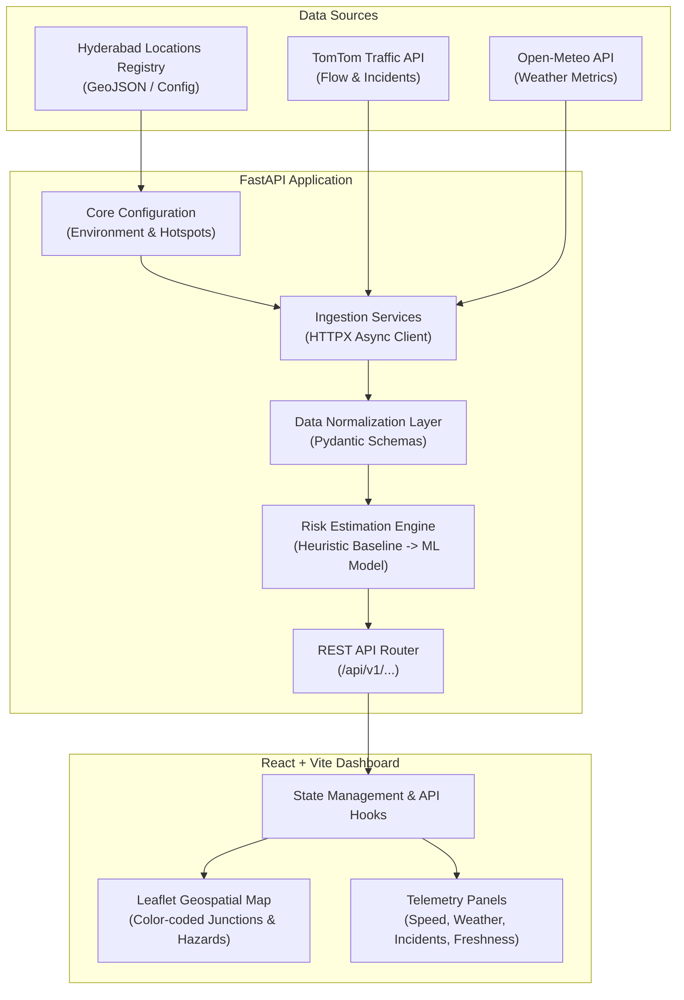

# System Architecture & Data Flow

This document details the architectural layout, component boundaries, and end-to-end data pipeline for the **Multimodal AI-Based Smart Traffic Management and Accident Prediction System**.

---

## 1. Architectural Philosophy

The application employs a decoupled client-server architecture built on **FastAPI (Python)** and **React (TypeScript + Vite)**.



---

## 2. End-to-End Data Pipeline

The live data pipeline operates in five distinct, sequential phases:

```
[1. Hyderabad Location Configuration]
                 │
                 ▼
[2. Traffic & Weather Ingestion (TomTom & Open-Meteo)]
                 │
                 ▼
[3. Backend Data Normalization (Pydantic Schemas)]
                 │
                 ▼
[4. Incident Processing & Accident Risk Estimation]
                 │
                 ▼
[5. Frontend Visualization Dashboard (React + Leaflet)]
```

### Step 1: Hyderabad Location Configuration
- A curated registry defines critical traffic bottlenecks, junctions, and corridors across Hyderabad (e.g., Gachibowli Junction, Cyber Towers / HITEC City, Punjagutta Circle, Mehdipatnam, Secunderabad Station, Dilsukhnagar, LB Nagar).
- Each entry provides:
  - Unique identifier (`id`) and human-readable name.
  - Coordinate point (`latitude`, `longitude`).
  - Bounding box / segment radius for traffic flow queries.
  - Road metadata (e.g., arterial road, flyover, junction type).

### Step 2: Traffic and Weather API Ingestion
- The backend initiates concurrent asynchronous HTTP requests using `httpx` with strict timeout controls (e.g., 5 seconds) to prevent cascading failures.
- **Traffic Telemetry (TomTom):**
  - Traffic Flow: Retrieves current travel speed (`currentSpeed`), normal free-flow speed (`freeFlowSpeed`), and current travel delay.
  - Traffic Incidents: Queries active reported events (road accidents, blockages, maintenance, lane closures) within the location's bounding perimeter.
- **Weather Telemetry (Open-Meteo):**
  - Queries precipitation rate, rain intensity, surface visibility, and wind conditions.

### Step 3: Backend Data Normalization
- Raw vendor responses are transformed into clean, strongly typed Pydantic models.
- Calculates derived metrics:
  - **Speed Ratio / Congestion Index**: $\text{Congestion Index} = 1.0 - \frac{\text{Current Speed}}{\text{Free Flow Speed}}$ (bounded between 0.0 and 1.0).
  - Standardizes weather conditions into unified severity factors (e.g., clear, light rain, heavy rain, dense fog).
  - Formats timestamps to ISO 8601 UTC with freshness indicators.

### Step 4: Incident Processing & Accident Risk Estimation
- **Incident Processing:** Distinguishes verified provider-reported occurrences from theoretical risk. Incidents are categorized by severity, impact radius, and delay.
- **Risk Estimation Engine:**
  - *Provisional Heuristic Baseline (Phases 1-3):* A deterministic, explainable algorithm combining:
    - Base road risk factor (historical junction complexity).
    - Congestion and sudden speed drop penalty.
    - Weather hazard multipliers (wet roads, low visibility).
    - Temporal multipliers (peak hour rush, night hours).
  - *Evaluated ML Model (Phases 4-5):* A trained supervised model (e.g., XGBoost / Random Forest) using historical Hyderabad accident data, producing calibrated probability distributions.

### Step 5: Frontend Dashboard
- The React application polls or loads the aggregated backend endpoints (`/api/v1/traffic-summary`, `/api/v1/locations/{id}/risk`).
- Highlights:
  - **Geospatial Map (Leaflet):** Pins locations with intuitive risk rings (Green = Low, Amber = Moderate, Orange = High, Crimson = Severe).
  - **Incident Layer:** Distinct marker overlays showing active reported hazard points.
  - **Telemetry Cards:** Displays speed delta, weather conditions, and risk breakdown.
  - **Data Freshness Indicator:** Highlights data timestamp and alerts if external data sources are unavailable or degraded.

---

## 3. Layer Responsibilities & Boundaries

| Component | Responsibility | Explicit Non-Responsibilities |
|---|---|---|
| **Backend Core & Config** | Holds application settings, environment variables, and location definitions. | Storing hardcoded secrets or API keys in source files. |
| **Ingestion Services** | Fetches external APIs, handles retries, enforces timeouts, manages caching. | Executing UI logic or direct frontend callbacks. |
| **Normalization & Schemas** | Validates API schemas, translates vendor payloads into internal types. | Fabricating missing fields; failures must surface explicitly. |
| **Risk Estimation Engine** | Computes baseline or ML-based accident risk scores and confidence levels. | Altering raw API metrics or conflating congestion with incidents. |
| **FastAPI REST Routes** | Exposes documented, CORS-secured JSON endpoints with metadata. | Containing business calculation logic (delegates to services). |
| **Frontend Application** | Renders interactive Leaflet map, alerts, charts, and state cards. | Calling TomTom or Open-Meteo APIs directly; storing credentials. |
